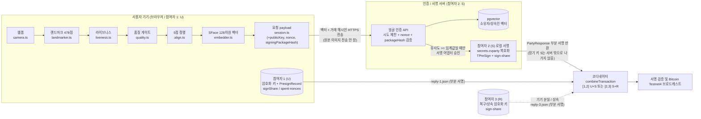

# Chronos Vault 얼굴인식 모듈 사용 가이드

`biometrics/` 폴더의 얼굴인식 모듈 연동 문서입니다. 송금 화면과 연결하는 순서는 [팀원 연동 가이드](README.md)에 있습니다.
Chronos Vault의 2-of-3 CGGMP20 임계서명 구조(참여자 1: 사용자 기기 `U`, 참여자 2: 인증/서명 서버 `S`, 참여자 3: 복구/상속 담당 `R`, `bitcoin/README.md` 참고)에서 얼굴인식은 **참여자 2(서버 `S`)가 거래 공동 서명(`TPreSign` / `sign-share`)을 승인하고 부분 서명(`PartyResponse`)을 반환할지 판단하는 본인/지정 상속인 확인 단계**만 담당합니다. 얼굴 벡터 자체가 키 조각이나 개인키 시드로 쓰이지 않으며, 서버 `S`의 장기 암호화 키 조각(`secrets.cvparty`)은 클라이언트로 전송되지 않습니다.

원본 카메라 이미지는 서버로 보내지 않고, 브라우저(기기) 안에서 라이브니스 검사와 128차원 L2 정규화 벡터 추출을 끝낸 뒤 벡터 문자열만 전달합니다.

---

## 1. 폴더 구조

```
biometrics/
  src/
    config.ts       # 차원(128), 기본/권장 임계값, 참여자 ID(PARTY_ID), 품질/라이브니스 기준값
    vector.ts       # L2 정규화, 코사인 유사도, pgvector 문자열 변환, 버퍼 wipe
    geometry.ts     # MediaPipe 478 랜드마크 기반 EAR, yaw/pitch/roll, 5점 정렬 변환
    liveness.ts     # 눈 깜빡임(EAR 히스테리시스) + 고개 좌/우 회전 챌린지
    quality.ts      # 단일 얼굴, 눈 사이 거리, 정면 각도, 눈 뜸 여부 필터
    align.ts        # 112x112 5점 유사 변환 크롭 및 RGB NCHW 텐서 패킹
    landmarker.ts   # MediaPipe FaceLandmarker 래퍼
    embedder.ts     # SFace ONNX (onnxruntime-web) 추론 래퍼
    matcher.ts      # 코사인 매칭(verifyVector) 및 임계값 보정(calibrateThreshold)
    camera.ts       # getUserMedia 웹캠 열기/닫기 헬퍼
    session.ts      # 등록/인증 전체 흐름(BiometricsEngine) 및 API payload 빌더
    client.ts       # 프론트엔드 원콜 연동 헬퍼(enrollFaceWithServer, verifyTransactionWithFace)
    types.ts        # 프론트/서버 연동용 타입 정의
    index.ts        # 외부 export 진입점
  server/
    signing-session.mjs  # 백엔드 전용: 벡터 비교, 일회성 챌린지 저장소, 서명 서버 티켓 발급 헬퍼
    signing-session.d.mts # 백엔드 헬퍼 TypeScript 타입 선언 (`@chronos-vault/biometrics/server`)
  scripts/
    fetch-models.mjs # MediaPipe / SFace 모델 다운로드 및 SHA-256 검증
    copy-assets.mjs  # 모델과 wasm 런타임 파일을 다른 앱의 정적 폴더로 복사
  models/            # fetch-models 실행 후 모델 바이너리 저장 (git 미추적)
  demo/              # 웹캠 단독 테스트용 페이지 (Vite)
  test/              # Vitest 단위 테스트 및 SFace ONNX 통합 테스트
  eval/              # 실제 얼굴 쌍(LFW) 정확도 평가 페이지 (Vite, 얼굴 데이터는 git 미포함)
```

---

## 2. 설치 및 로컬 테스트

Node.js 20 이상에서 동작합니다. 모델 파일(`.onnx`, `.task`)은 용량 때문에 git에 올리지 않았고 스크립트로 받아서 쓰도록 해 두었습니다.

```bash
cd biometrics
npm install
npm run fetch-models
```

`fetch-models`를 실행하면 아래 두 파일이 `biometrics/models/`에 받아지고 SHA-256 체크섬까지 확인합니다.

- `face_landmarker.task` (MediaPipe Face Landmarker, 약 3.6MB)
- `face_recognition_sface_2021dec.onnx` (OpenCV Zoo SFace, Apache-2.0, 약 38.7MB)

테스트 및 단독 웹캠 데모 실행:

```bash
npm run typecheck
npm test
npm run dev
```

`npm run dev` 실행 후 브라우저에서 `http://localhost:5179`로 들어가면 소유자(`owner`)와 상속인(`heir`) 얼굴을 각각 등록하고, 라이브니스 통과 후 코사인 유사도와 서버로 보낼 JSON payload를 바로 확인할 수 있습니다.

### 2.1 다른 프로젝트(팀원 앱)에서 불러오기

같은 레포 안의 다른 프론트엔드 프로젝트에서 이 모듈을 패키지처럼 불러오는 방법입니다. 새로 클론한 상태에서 아래 순서대로 하면 됩니다.

1. **biometrics 쪽 준비 (한 번만)**: 앱에서 `npm install`을 해도 biometrics가 쓰는 MediaPipe와 ONNX Runtime은 같이 설치되지 않으므로, biometrics 폴더에서 직접 설치해야 합니다.
   ```bash
   cd biometrics
   npm install
   npm run fetch-models
   ```
2. **앱에 의존성 추가** (앱 폴더가 레포 루트 바로 아래에 있다고 가정, 예: `web/`):
   ```bash
   cd ../web
   npm install ../biometrics
   ```
   `package.json`에 `"@chronos-vault/biometrics": "file:../biometrics"`가 추가됩니다.
3. **모델과 wasm 파일 복사**: 브라우저가 실행 중에 받아 가는 파일들을 앱의 정적 폴더로 복사합니다. 모델을 다시 받거나 패키지를 업데이트한 뒤에도 다시 실행합니다.
   ```bash
   cd ../biometrics
   npm run copy-assets -- ../web/public
   ```
   `public/models/`, `public/ort-wasm/`, `public/mp-wasm/`이 만들어지며, 3.1의 경로(`/models/...`, `/ort-wasm/`, `/mp-wasm`)와 그대로 맞습니다.
4. **코드에서 사용**:
   ```ts
   import { BiometricsEngine, buildVerifyPayload, verifyVector } from '@chronos-vault/biometrics';
   ```

- 패키지는 TypeScript 소스를 그대로 내보내므로 Vite, webpack 등 TS를 처리하는 번들러에서 바로 동작합니다. Vite + `tsc` 조합으로 새로 클론한 상태에서 위 순서대로 설치, 빌드, 실행(같은 사람 사진 유사도 `0.84` 일치, 다른 사람 `-0.02` 불일치, 서버 payload 생성)까지 확인했습니다.
- Next.js에서는 `next.config.js`에 `transpilePackages: ['@chronos-vault/biometrics']`를 추가해야 합니다.
- **서명 래퍼와의 연결**. 얼굴 모듈은 `buildEnrollPayload()`와 `buildVerifyPayload()`로 인증 핸들러에 보낼 JSON을 만듭니다. 핸들러가 이번 거래의 인증을 마치면 S에서 받은 `ticket`을 프론트로 반환하고, 프론트는 이를 `signWithServer()`에 전달합니다.

---

## 3. 프론트엔드 연동 방법

### 3.1 초기화와 카메라 연결

앱에서 얼굴 인증 화면에 들어갈 때 모델과 카메라를 준비합니다. 모델 파일과 wasm 파일은 프론트엔드 정적 경로(예: Next.js `public/models/`, `public/ort-wasm/`, `public/mp-wasm/`)에 두거나 CDN 경로를 넘기면 됩니다.

```ts
import {
  BiometricsEngine,
  PARTY_ID,
  RECOMMENDED_VAULT_THRESHOLD,
  openCamera,
  stopCamera,
  buildEnrollPayload,
  buildVerifyPayload,
  hashSigningPackage,
  type SessionProgress,
} from '../biometrics/src';

const videoEl = document.querySelector('video')!;
const stream = await openCamera(videoEl, { width: 640, height: 480, facingMode: 'user' });

const engine = await BiometricsEngine.create({
  paths: {
    mediapipeWasmBaseUrl: '/mp-wasm',
    faceLandmarkerModelUrl: '/models/face_landmarker.task',
    embeddingModelUrl: '/models/face_recognition_sface_2021dec.onnx',
    onnxWasmBaseUrl: '/ort-wasm/',
  },
});
```

화면을 벗어날 때는 반드시 카메라와 엔진을 정리해야 합니다.

```ts
stopCamera(videoEl, stream);
await engine.dispose();
```

### 3.2 얼굴 등록 (지갑 생성 시 소유자 / 지정 상속인)

이 절의 `/api/vault/face/enroll`과 다음 절의 `/api/vault/face/verify`는 통합 앱에서 구현할 경로 예시입니다. 지갑별 등록 자료 저장과 대조는 인증 핸들러가 담당합니다.

등록은 라이브니스(랜덤 순서로 눈 1회 깜빡임 + 좌/우 고개 회전 1회) 통과 후 정면 품질 기준을 만족하는 프레임 5장을 추출해 평균/정규화합니다. 5장 사이의 일관성이 기준(`minSampleConsistency = 0.5`)보다 낮으면 실패 처리합니다.

```ts
const controller = new AbortController();

const enrolled = await engine.enroll(videoEl, {
  lang: 'ko',
  signal: controller.signal,
  onProgress(p: SessionProgress) {
    // p.stage: 'liveness' | 'capturing' | 'done' | 'failed'
    // p.message: 화면 안내 문구 ("눈을 한 번 깜빡여 주세요", "카메라에 조금 더 가까이 와 주세요" 등)
    // p.samplesCollected / p.samplesTarget: 진행률 표시용
    setGuideText(p.message);
  },
});

// role: 'owner' | 'heir'
// publicKey: bitcoin/ threshold-runner keygen으로 생성된 33바이트 압축 SEC1 공동 공개키(public-key.json)
const payload = buildEnrollPayload(vaultId, 'owner', enrolled, {
  publicKey: masterPublicKeyHex,
  challengeNonce: serverNonce,
});

await fetch('/api/vault/face/enroll', {
  method: 'POST',
  headers: { 'Content-Type': 'application/json' },
  body: JSON.stringify(payload),
});
```

등록 취소 버튼에서는 `controller.abort()`를 호출하면 루프가 즉시 중단되고 `BiometricsSessionError` (`code === 'aborted'`)가 발생합니다.

### 3.3 얼굴 인증 (참여자 2 서버 `S` 공동 서명 승인 요청)

일반 서명(`purpose: 'normal_sign'`, 서명자 `[1, 2]`), 분실 복구(`purpose: 'recovery'`, 서명자 `[2, 3]`), 사후 상속(`purpose: 'inheritance'`, 서명자 `[2, 3]`) 모두 같은 `verify()` 함수를 사용합니다.

`bitcoin/` 코디네이터가 만든 `SigningPackage` JSON(`prepareTransaction` 또는 `payment.json`)의 SHA-256 해시(`hashSigningPackage`)와 서버가 발급한 일회성 `challengeNonce`를 함께 묶어 보내면, 인증 결과가 다른 송금 요청에 재사용되는 것을 막을 수 있습니다.

```ts
const captured = await engine.verify(videoEl, {
  lang: 'ko',
  onProgress(p) {
    setGuideText(p.message);
  },
});

const signingPackageHash = await hashSigningPackage(signingPackageJson);
const payload = buildVerifyPayload(vaultId, 'heir', 'inheritance', captured, {
  publicKey: masterPublicKeyHex,
  challengeNonce: serverNonce,
  signingPackageHash,
  signers: JSON.parse(signingPackageJson).signers, // 검토한 거래의 두 참여자와 순서를 보존
});

const res = await fetch('/api/vault/face/verify', {
  method: 'POST',
  headers: { 'Content-Type': 'application/json' },
  body: JSON.stringify(payload),
});
if (!res.ok) throw new Error('얼굴 인증 요청 실패');
const data = await res.json();
if (!data.verified || !data.ticket) throw new Error('이 거래의 서명 티켓을 받지 못했습니다');
const signed = await signWithServer({
  packageJson: signingPackageJson, purpose: 'inheritance', ticket: data.ticket, files: rFiles,
});
```

위 예제의 `signWithServer`는 브라우저 서명 래퍼에서 가져오고, `rFiles`에는 R의 로컬 파일 세 개를 전달합니다. 인증 핸들러가 챌린지의 지갑·목적·거래 해시·서명자와 등록된 신청자 정보를 대조하고 일회성 nonce를 소비한 뒤, S 서버에서 받은 `ticket`을 반환합니다. S의 부분서명은 티켓을 사용한 라운드가 끝날 때 래퍼에 전달됩니다. 별도 네이티브 어댑터에 사용하는 응답 형식(`partyResponse`, `approvalToken`)도 타입에 유지되어 있습니다. [서명 서버 연동 가이드](bitcoin/SIGNING_SERVER.md)

백엔드 붙이기 전에 프론트 단독으로 매칭 테스트를 해 보려면 `engine.verifyLocal(videoEl, referenceVector, { lang: 'ko', threshold: RECOMMENDED_VAULT_THRESHOLD })`를 사용하면 됩니다.

**프론트엔드 원콜(drop-in) 헬퍼 사용하기 (`client.ts`)**

위처럼 `hashSigningPackage`, `buildVerifyPayload`, `fetch`, 응답 검사를 매번 직접 작성하지 않고 `enrollFaceWithServer` / `verifyTransactionWithFace` 한 번의 호출로 끝낼 수 있습니다. `packageJson`의 원문 해시 계산과 `public_key`·`signers` 추출까지 자동으로 처리합니다.

```ts
import { enrollFaceWithServer, verifyTransactionWithFace } from '@chronos-vault/biometrics';

// 1) 얼굴 등록
await enrollFaceWithServer({
  engine,
  video: videoEl,
  vaultId,
  role: 'owner',
  enrollUrl: '/api/vault/face/enroll',
  publicKey: masterPublicKeyHex,
  challengeNonce: serverNonce,
  lang: 'ko',
  onProgress: (p) => setGuideText(p.message),
});

// 2) 거래 서명용 얼굴 인증 → 티켓 수신 → signWithServer() 전달
const { response, ticket } = await verifyTransactionWithFace({
  engine,
  video: videoEl,
  vaultId,
  role: 'owner',
  purpose: 'normal_sign',
  packageJson: signingPackageJson, // 원문 그대로 전달 (publicKey, signers 자동 추출)
  verifyUrl: '/api/vault/face/verify',
  challengeNonce: serverNonce,
  lang: 'ko',
  onProgress: (p) => setGuideText(p.message),
});

if (!response.verified || !ticket) {
  throw new Error(`얼굴 인증 실패 (유사도 ${response.similarity.toFixed(3)})`);
}
const signed = await signWithServer({
  packageJson: signingPackageJson, purpose: 'normal_sign', ticket, files: uFiles,
});
```

### 3.4 에러 코드 정리

`enroll`과 `verify`에서 발생할 수 있는 `BiometricsSessionError.code` 값입니다.

- `aborted`: 사용자가 `AbortController`로 취소함
- `liveness_failed`: 제한 시간(기본 15초) 초과 또는 화면에 2명 이상 감지됨
- `capture_timeout`: 라이브니스 통과 후 정면 품질 조건을 만족하는 프레임을 시간 내 수집하지 못함
- `inconsistent_samples`: 등록 중 수집된 5프레임 간 벡터 편차가 너무 큼 (중간에 사람이 바뀌었거나 심하게 흔들린 경우)
- `video_not_ready`: `<video>` 스트림이 아직 준비되지 않음

### 3.5 정지 이미지에서 벡터 추출 (`extractFromImage`)

사진 파일이나 캔버스에서 바로 벡터를 뽑을 때 사용합니다. 라이브니스 검사가 없으므로 **참여자 2(서버 `S`) 서명 승인 인증에는 쓰지 말고**, 테스트나 데이터 확인 용도로만 사용하세요.

```ts
const img = await loadImage('/some-face.jpg'); // HTMLImageElement, canvas, ImageBitmap 등
const vector = await engine.extractFromImage(img);
```

- 얼굴이 없으면 `no_face`, 두 명 이상이면 `multiple_faces` 오류가 납니다.
- 뒤에 작게 다른 사람이 찍힌 사진도 받으려면 `allowBackgroundFaces`를 켭니다. 가장 큰 얼굴의 눈 사이 거리가 다른 모든 얼굴의 1.6배(`DEFAULT_DOMINANCE_RATIO`) 이상일 때만 그 얼굴을 쓰고, 비슷한 크기의 얼굴이 둘이면 여전히 `multiple_faces`로 거부합니다.

```ts
const vector = await engine.extractFromImage(img, undefined, { allowBackgroundFaces: true });
// 비율을 직접 정하려면: { allowBackgroundFaces: true, dominanceRatio: 2.0 }
```

- 웹캠 등록/인증(`enroll`, `verify`)은 이 옵션과 상관없이 항상 2명 이상이 잡히면 실패합니다.

### 3.6 휴대폰 브라우저(모바일 웹)에서 사용할 때

Chronos Vault는 브라우저 기반 앱이라 휴대폰에서도 같은 코드가 그대로 동작합니다. iPhone Safari에서 데모 페이지로 등록(눈 깜빡임, 고개 회전)과 인증이 정상 동작하는 것을 확인했습니다. 휴대폰에서는 아래 사항을 지켜야 합니다.

- **HTTPS 필수**: 휴대폰 브라우저는 보안 연결(HTTPS) 페이지에서만 카메라를 허용합니다. 개발 중 `http://localhost`는 예외지만, 같은 와이파이의 PC 주소(`http://192.168...`)로 접속하면 카메라가 열리지 않습니다.
- **첫 로딩 용량**: 모델 두 개가 약 42MB입니다. 브라우저 캐시에 남으므로 두 번째부터는 빠르지만, 모바일 데이터에서는 첫 로딩이 느립니다. 얼굴 인증 화면에 들어가기 전에 `BiometricsEngine.create()`를 미리 호출해 두고 "얼굴 인증 준비 중" 같은 안내를 보여 주는 것을 권장합니다.
- **전면 카메라**: `openCamera()`는 기본으로 전면 카메라(`facingMode: 'user'`)를 엽니다.
- **메모리 정리**: 모델이 올라가 있는 동안 탭이 수백 MB를 사용합니다. 오래된 iPhone은 메모리가 부족하면 페이지를 다시 불러오므로, 얼굴 인증 화면을 벗어날 때 `stopCamera()`와 `engine.dispose()`를 꼭 호출하세요.
- **속도**: 저사양 휴대폰은 PC보다 몇 배 느릴 수 있습니다. 라이브니스 단계는 프레임 속도에 영향을 받으므로 실제 대상 기기에서 한 번씩 확인하는 것이 좋습니다.
- **iPhone 브라우저**: iPhone의 모든 브라우저(Chrome 포함)는 Safari 엔진을 씁니다. 나중에 웹앱을 네이티브 앱(WebView)으로 감쌀 경우에는 카메라 권한과 인라인 미디어 재생 설정을 별도로 켜야 합니다.

**휴대폰으로 직접 테스트하기 (Tailscale 사용 예)**

개발 PC와 휴대폰이 같은 Tailscale 계정에 연결되어 있으면, 별도 인증서 없이 HTTPS 주소로 데모를 열 수 있습니다. 이 주소는 같은 Tailscale 계정의 기기에서만 열리고 인터넷에는 공개되지 않습니다.

```bash
cd biometrics
npm run dev                                   # http://localhost:5179
tailscale serve --bg --https=443 http://127.0.0.1:5179
# 휴대폰 Safari/Chrome에서 https://<PC 이름>.<tailnet>.ts.net/ 접속
tailscale serve --https=443 off               # 테스트가 끝나면 종료
```

처음 한 번은 Tailscale 관리 페이지에서 Serve(HTTPS 인증서) 사용을 허용해야 합니다. Vite가 외부 호스트 이름을 막으면 `demo/vite.config.ts`의 `server.allowedHosts`에 위 주소를 추가합니다.

---

## 4. 서버 및 DB(pgvector) 연동 규격

### 4.1 요청 JSON 형식

등록 (`FaceEnrollPayload`):

```json
{
  "vaultId": "vault-uuid",
  "role": "owner",
  "embedding": "[0.01234567,-0.08912345,...]",
  "liveness": {
    "steps": ["blink", "turn_left"],
    "blinkCount": 1,
    "durationMs": 2840
  },
  "publicKey": "0279be667ef9dcbbac55a06295ce870b07029bfcdb2dce28d959f2815b16f81798",
  "challengeNonce": "srv-nonce-one-time-uuid"
}
```

인증 (`FaceVerifyPayload`):

```json
{
  "vaultId": "vault-uuid",
  "role": "heir",
  "purpose": "inheritance",
  "embedding": "[0.01198234,-0.09041122,...]",
  "liveness": {
    "steps": ["turn_right", "blink"],
    "blinkCount": 1,
    "durationMs": 3120
  },
  "publicKey": "0279be667ef9dcbbac55a06295ce870b07029bfcdb2dce28d959f2815b16f81798",
  "challengeNonce": "srv-nonce-one-time-uuid",
  "signingPackageHash": "a3f1...64hex",
  "signers": [2, 3]
}
```

- `embedding`은 `Float32Array(128)`을 L2 정규화한 뒤 pgvector 텍스트 리터럴(`"[v0,v1,...,v127]"`)로 직렬화한 값입니다.
- `publicKey`, `challengeNonce`, `signingPackageHash`, `signers`는 선택 필드이며, `buildEnrollPayload`/`buildVerifyPayload`의 마지막 옵션 인자로 넘기면 형식 검증(33바이트 압축 SEC1 hex, 64자리 SHA-256 hex, 서로 다른 참여자 ID 쌍 `{1,2,3}`)을 거쳐 포함됩니다.

### 4.2 pgvector 코사인 유사도 비교

`pgvector`의 `<=>` 연산자는 코사인 거리(`1 - cosine_similarity`)를 반환합니다. 클라이언트 `verifyVector()`가 계산하는 `similarity` 및 `distance`와 식이 동일합니다.

```sql
-- 테이블 컬럼 예시
-- public_key      text UNIQUE NOT NULL  -- bitcoin/ public-key.json (33바이트 압축 SEC1 hex)
-- owner_embedding vector(128)
-- heir_embedding  vector(128)

SELECT
  1 - (owner_embedding <=> $1::vector(128)) AS similarity
FROM vaults
WHERE id = $2
  AND public_key = $3
  AND (1 - (owner_embedding <=> $1::vector(128))) >= $4;
```

상속(`role = 'heir'`, `purpose = 'inheritance'`)은 지정 상속인 등록 기록, 사망 증빙 또는 비활성 타임락 충족, 검토한 거래의 `signingPackageHash`와 S·R 서명자 조합까지 확인합니다. 브라우저는 S가 발급한 티켓으로 라운드를 시작하고, S와 R은 각자 보관한 키 조각으로 참여합니다.

### 4.3 임계값(threshold) 설정 주의사항

초기 기획 문서에는 코사인 임계값이 `0.85`로 적혀 있는데, **현재 모델(SFace)에 `0.85`를 그대로 적용하면 본인도 대부분 거부됩니다.**

- OpenCV 공식 SFace 코사인 기준값은 `0.363` (`SFACE_COSINE_THRESHOLD`)입니다.
- 실제 웹캠 환경에서는 같은 사람이라도 조명과 각도에 따라 보통 `0.45 ~ 0.75` 정도가 나오고, 다른 사람은 대개 `-0.10 ~ 0.25` 구간에 분포합니다.
- 통합 단계에서 팀원 4명 얼굴로 같은 사람(genuine) / 다른 사람(impostor) 유사도 점수를 몇 쌍씩 모아 `calibrateThreshold(genuineScores, impostorScores, { targetFar: 0.01 })`을 돌려본 뒤, 최종 확정된 숫자를 프론트와 서버 SQL의 `$3`에 같이 맞춰 넣으면 됩니다.

### 4.4 실제 얼굴 데이터로 검증한 결과 (LFW)

이 모듈의 실제 파이프라인(MediaPipe 랜드마크 → 5점 정렬 → SFace 벡터 → 코사인 유사도)을 공개 얼굴 인식 벤치마크 LFW(Labeled Faces in the Wild)의 표준 개발용 쌍으로 헤드리스 Chrome에서 그대로 돌린 결과입니다. 각 쌍은 같은 사람 사진 2장 또는 다른 사람 사진 2장입니다.

| 데이터 | 비교된 쌍 | 임계값 0.363 정확도 | 다른 사람을 통과시킨 비율 (오수락) | 본인을 거부한 비율 (오거부) | 다른 사람 최고 점수 |
| :--- | ---: | ---: | ---: | ---: | ---: |
| LFW 1,000쌍 | 856 | 99.30% | 0.00% (0 / 438) | 1.44% (6 / 418) | 0.360 |
| LFW 2,200쌍 (`allowBackgroundFaces`) | 1,963 | 99.64% | 0.20% (2 / 980) | 0.51% (5 / 983) | 0.367 |

- 같은 사람 평균 유사도는 약 `0.69`, 다른 사람 평균은 약 `0.09`로 4.3의 웹캠 기준 범위와도 맞습니다.
- 사진에 여러 명이 찍힌 쌍은 비교에서 빠집니다 (1,000쌍 중 144쌍, 2,200쌍 중 231쌍, 얼굴 미검출 6쌍). 실제 사용 환경(웹캠 1인)에서는 해당되지 않습니다.
- 기본값 `0.363`에서 2,200쌍 중 다른 사람 2쌍(최고 `0.367`)이 통과했습니다. 임계값별 결과는 아래와 같습니다.

| 임계값 | 1,000쌍 오수락 / 오거부 | 2,200쌍 오수락 / 오거부 |
| ---: | :--- | :--- |
| 0.363 (현재 기본값) | 0.00% / 1.44% | 0.20% / 0.51% |
| 0.40 | 0.00% / 1.44% | 0.00% / 0.92% |
| 0.45 | 0.00% / 2.15% | 0.00% / 2.03% |
| 0.50 | 0.00% / 4.07% | 0.00% / 4.27% |

(1,000쌍은 기본 설정, 2,200쌍은 `allowBackgroundFaces` 사용 결과입니다.)

- **권장**: 얼굴 인증 결과로 참여자 2(서버 `S`)의 공동 서명을 승인하는 구조에서는 다른 사람 통과가 더 위험하므로, 두 데이터 모두에서 오수락이 0이었던 `0.40` (`RECOMMENDED_VAULT_THRESHOLD`) 이상을 출발점으로 삼고 4.3의 보정 절차(실제 조명/카메라 환경)로 최종 값을 정하는 것을 권장합니다. 코드의 `SFACE_COSINE_THRESHOLD`(0.363)는 모델 기준값이라 그대로 두고 `RECOMMENDED_VAULT_THRESHOLD`(0.40)를 별도로 export합니다.

**직접 다시 돌려보는 방법**

1. LFW 쌍 이미지를 `<폴더>/<split>/<번호>_0.jpg`, `<번호>_1.jpg`, `<폴더>/<split>/labels.json` (`[{ "i": 0, "same": 1, "ext": "jpg" }, ...]`) 형태로 준비합니다. 얼굴 사진은 저장소에 올리지 않습니다.
2. 평가 서버 실행:
   ```bash
   cd biometrics
   LFW_DIR=<폴더> npx vite eval --config eval/vite.config.ts
   ```
3. 브라우저에서 `http://localhost:5180/?split=train` (뒷배경 얼굴 허용은 `&bg=1`)을 열면 모든 쌍을 처리한 뒤 결과가 `window.__lfw.results`(쌍별 유사도)에 담깁니다. 1,000쌍 기준 약 7~8분 걸립니다.

### 4.5 백엔드 드롭인 헬퍼 (`@chronos-vault/biometrics/server`)

Node.js 백엔드(Express/Fastify/Hono/Next.js API Route 등)에서는 외부 의존성 없는 `@chronos-vault/biometrics/server` (`biometrics/server/signing-session.mjs`)를 가져다 쓰면 서명 서버(`threshold-runner serve`)와의 연동 보일러플레이트를 크게 줄일 수 있습니다.

- `fetchSigningContext(signerUrl)` — `GET /v1/signing/context`로 `instanceId`와 `publicKey` 조회
- `createChallengeStore({ ttlSeconds })` — 일회성 `challengeNonce` 발급(`issue`) 및 검증·소비(`consume`, 리플레이·만료·거래 해시 불일치 차단)
- `verifyFaceEmbedding(probe, stored, threshold)` — pgvector 리터럴(`"[v0,...,v127]"`) 또는 배열 간 코사인 유사도 비교 (기본 임계값 `RECOMMENDED_VAULT_THRESHOLD = 0.40`). PostgreSQL pgvector SQL 대신 메모리 비교가 필요할 때 바로 사용 가능
- `buildSigningSessionRequest(packageJson, verification, privateKey)` — Ed25519 서명이 포함된 `POST /v1/signing/sessions` 요청 바디 생성
- `issueSigningTicket(signerUrl, packageJson, verification, privateKey)` — 서명 요청 생성부터 `POST /v1/signing/sessions` 호출 및 `{ ticket, expiresInSeconds }` 반환까지 한 번에 수행
- `authorizeFaceAndIssueTicket(options)` — 위 단계를 하나로 묶어 `FaceVerifyServerResponse` 형식(`{ verified, similarity, ticket, expiresInSeconds }`)을 바로 반환

```ts
import { readFileSync } from 'node:fs';
import {
  authorizeFaceAndIssueTicket,
  createChallengeStore,
  fetchSigningContext,
} from '@chronos-vault/biometrics/server';

const SIGNER_URL = process.env.CHRONOS_SIGNER_URL!; // 예: http://127.0.0.1:8080
const AUTH_PRIVATE_KEY = readFileSync(process.env.CHRONOS_AUTH_PRIVATE_KEY_PATH!);
const challenges = createChallengeStore({ ttlSeconds: 120 });

// 1) 챌린지 발급 라우트 (POST /api/vault/face/challenge)
const { instanceId, publicKey } = await fetchSigningContext(SIGNER_URL);
const challenge = challenges.issue({
  vaultId,
  publicKey,
  instanceId,
  packageJson,
  purpose,
  role,
});

// 2) 얼굴 인증 및 서명 티켓 발급 라우트 (POST /api/vault/face/verify)
const result = await authorizeFaceAndIssueTicket({
  signerUrl: SIGNER_URL,
  packageJson,        // 서버가 보관한 검토된 거래 원문 JSON
  payload: req.body,  // 프론트에서 온 FaceVerifyPayload
  storedEmbedding,    // DB에 저장된 owner_embedding 또는 heir_embedding
  privateKey: AUTH_PRIVATE_KEY,
  challengeStore: challenges,
  inheritanceEvidence: purpose === 'inheritance' ? 'death_verified' : null,
});
// result: { verified: true, similarity: 0.72, ticket: '...', expiresInSeconds: 600 }
// (또는 불일치 시 서명 서버를 호출하지 않고 { verified: false, similarity: 0.14, reason: 'face_mismatch' })
```

DB의 pgvector 쿼리(4.2절)로 직접 유사도를 비교하는 경우에도 `createChallengeStore`, `fetchSigningContext`, `issueSigningTicket`만 골라 조합할 수 있습니다.

---

## 5. 내부 처리 파이프라인

1. **랜드마크 추출 (`landmarker.ts`)**: MediaPipe Face Landmarker로 478개 3D 랜드마크를 추출합니다. `numFaces: 2`로 설정해 2명 이상이 동시에 잡히면 즉시 실패 처리합니다.
2. **라이브니스 검사 (`liveness.ts`, `geometry.ts`)**:
   - 눈 종횡비(EAR)에 히스테리시스(`earClosed = 0.18`, `earOpen = 0.24`)와 지속 시간 범위(`40ms ~ 500ms`)를 적용해 노이즈나 눈을 계속 감고 있는 경우를 거릅니다.
   - 눈 깜빡임 도중 얼굴이 프레임에서 사라지면 진행 중이던 깜빡임 상태를 취소해 카메라를 가렸다 떼는 식의 우회를 막습니다.
   - 고개 회전 단계는 정면 중앙 상태를 먼저 거친 뒤 `yaw`가 18도 이상 움직여야 통과됩니다.
3. **품질 게이트 (`quality.ts`)**: 눈 사이 거리 60px 미만, 얼굴 프레임 경계 이탈, yaw/pitch 20도 초과, 눈 감김 프레임은 벡터 추출에서 제외합니다.
4. **얼굴 정렬 (`align.ts`)**: 양쪽 눈 중심, 코끝, 양쪽 입꼬리 5점을 OpenCV SFace 기준 112x112 템플릿(`ARCFACE_TEMPLATE_112`)에 유사 변환(회전 + 균등 스케일 + 평행이동)으로 맞춘 뒤 RGB planar NCHW `[1, 3, 112, 112]` (`0..255` float32) 텐서로 변환합니다.
5. **벡터 추출 및 메모리 정리 (`embedder.ts`, `vector.ts`)**: SFace ONNX 추론으로 128차원 벡터를 뽑아 L2 정규화합니다. 추출 직후 임시 캔버스, RGBA 픽셀 버퍼, 입력 텐서, 추론 출력 버퍼, 등록용 개별 샘플 벡터는 모두 `wipe()`로 0으로 덮어씁니다.

---

## 6. 보안 범위 및 한계

- **막을 수 있는 것**: 정지 사진(인쇄물, 휴대폰 화면 사진), 다중 인물 동시 프레임, 카메라 가림으로 인한 가짜 깜빡임, 원본 얼굴 이미지의 서버 유출.
- **클라이언트 모듈만으로 막기 어려운 것**:
  - 등록된 사용자의 눈 깜빡임과 고개 회전을 고화질 영상으로 녹화해 재생하는 리플레이 공격.
  - 변조된 클라이언트가 `liveness` 검사를 건너뛰고 과거에 탈취한 128차원 벡터를 서버 API에 직접 전송하는 공격.
- 따라서 실제 서비스/통합 서버에서는 얼굴 인증 API에 **시도 횟수 제한(rate limiting)**, 세션 nonce/타임스탬프 바인딩, 그리고 상속 요청 시 지정 기록 및 사망 증빙(또는 타임락) 서버 검증을 반드시 함께 적용해야 합니다.

---

## 7. 권장 구성도 (`bitcoin/` 2-of-3 CGGMP20 임계서명 연동)

아래는 얼굴인식 모듈을 `bitcoin/`의 2-of-3 CGGMP20 임계서명(참여자 1=`U`, 참여자 2=`S`, 참여자 3=`R`, 암호화 저장소 `party_store.rs`) 및 인증 서버/DB와 연결할 때 권장하는 구성입니다. 현재 저장소에는 기기 쪽 얼굴인식 모듈(`biometrics/`)과 임계서명 지갑(`bitcoin/`, `threshold-online/`, 루트 CGGMP20)이 구현되어 있고, 인증 API/DB 부분은 통합 서버 구현 시 참고용 규격입니다.



**연결 시 권장 사항**

- **얼굴은 참여자 2(서버 `S`)의 공동 서명 승인만 담당합니다.** 벡터는 키 조각이나 시드로 쓰지 않으며, 참여자 2의 암호화 키 조각(`secrets.cvparty` + `.key`)은 서버 안에서만 복호화해 `TPreSign`/`sign-share`를 수행하고 결과인 부분 서명(`PartyResponse`)만 반환합니다.
- **비교는 서버(DB)에서 합니다.** 기기가 보낸 벡터를 4.2의 pgvector 쿼리로 저장된 소유자/상속인 벡터와 비교하고, 기기 쪽 `verifyLocal` 결과는 화면 안내용으로만 씁니다.
- **요청마다 서버 nonce와 거래 해시(`signingPackageHash`)를 묶습니다.** 탈취한 과거 벡터나 이전 거래 승인을 재사용하는 공격(6절)을 막기 위해 `challengeNonce`는 일회성으로 만료시키고, `hashSigningPackage(paymentJson)`으로 검토된 `SigningPackage`(`public_key`, `signers`, 수신자, 금액)와 정확히 일치할 때만 서명 어댑터를 실행합니다.
- **시도 횟수 제한과 잠금**: 금고(`vaultId` / `publicKey`) 단위로 실패 횟수를 세고, 기준을 넘으면 일정 시간 잠그거나 별도 복구 절차를 거치게 합니다.
- **임계값은 한 곳에서 관리합니다.** 프론트의 `RECOMMENDED_VAULT_THRESHOLD`(0.40, 보정 후 확정값)와 서버 SQL의 `$4`가 항상 같은 값이 되도록 설정 파일 하나에서 읽어 오게 합니다.
- **소유자와 상속인 벡터는 따로 저장**하고, 상속인 인증(`role: 'heir'`, `signers: [2, 3]`)으로 참여자 2 공동 서명을 승인할 때는 지정 기록과 사망 증빙(또는 타임락)을 서버에서 함께 확인합니다.
- **벡터 DB 접근 제한**: 얼굴 벡터도 개인정보이므로 인증 API만 해당 테이블에 접근하게 하고, 전송은 HTTPS만 허용합니다.
