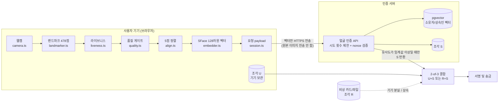

# Chronos Vault 얼굴인식 모듈 사용 가이드

`biometrics/` 폴더에 있는 얼굴인식 모듈 연동 문서입니다.
Chronos Vault의 2-of-3 Shamir 구조(사용자 기기 `U`, 인증 서버 `S`, 비상 카드/파일 `R`)에서 얼굴인식은 **인증 서버가 조각 `S`를 내려줄지 판단하기 위한 본인/지정 상속인 확인 단계**만 담당합니다. 얼굴 벡터 자체가 키 조각이나 개인키 시드로 쓰이지는 않습니다.

원본 카메라 이미지는 서버로 보내지 않고, 브라우저(기기) 안에서 라이브니스 검사와 128차원 L2 정규화 벡터 추출을 끝낸 뒤 벡터 문자열만 전달합니다.

---

## 1. 폴더 구조

```
biometrics/
  src/
    config.ts       # 차원(128), 기본 임계값, 품질/라이브니스 기준값
    vector.ts       # L2 정규화, 코사인 유사도, pgvector 문자열 변환, 버퍼 wipe
    geometry.ts     # MediaPipe 478 랜드마크 기반 EAR, yaw/pitch/roll, 5점 정렬 변환
    liveness.ts     # 눈 깜빡임(EAR 히스테리시스) + 고개 좌/우 회전 챌린지
    quality.ts      # 단일 얼굴, 눈 사이 거리, 정면 각도, 눈 뜸 여부 필터
    align.ts        # 112x112 5점 유사 변환 크롭 및 RGB NCHW 텐서 패킹
    landmarker.ts   # MediaPipe FaceLandmarker 래퍼
    embedder.ts     # SFace ONNX (onnxruntime-web) 추론 래퍼
    matcher.ts      # 코사인 매칭(verifyVector) 및 임계값 보정(calibrateThreshold)
    camera.ts       # getUserMedia 웹캠 열기/닫기 헬퍼
    session.ts      # 등록/인증 전체 흐름(BiometricsEngine) 및 API payload 빌더
    types.ts        # 프론트/서버 연동용 타입 정의
    index.ts        # 외부 export 진입점
  scripts/
    fetch-models.mjs # MediaPipe / SFace 모델 다운로드 및 SHA-256 검증
  models/            # fetch-models 실행 후 모델 바이너리 저장 (git 미추적)
  demo/              # 웹캠 단독 테스트용 페이지 (Vite)
  test/              # Vitest 단위 테스트 및 SFace ONNX 통합 테스트
  eval/              # 실제 얼굴 쌍(LFW) 정확도 평가 페이지 (Vite, 얼굴 데이터는 git 미포함)
```

---

## 2. 설치 및 로컬 테스트

Node.js 20 이상에서 동작합니다. 모델 파일(`.onnx`, `.task`)은 용량 때문에 git에 올리지 않았고 스크립트로 받아서 쓰도록 해 두었습니다.

```bash
cd biometrics
npm install
npm run fetch-models
```

`fetch-models`를 실행하면 아래 두 파일이 `biometrics/models/`에 받아지고 SHA-256 체크섬까지 확인합니다.

- `face_landmarker.task` (MediaPipe Face Landmarker, 약 3.6MB)
- `face_recognition_sface_2021dec.onnx` (OpenCV Zoo SFace, Apache-2.0, 약 38.7MB)

테스트 및 단독 웹캠 데모 실행:

```bash
npm run typecheck
npm test
npm run dev
```

`npm run dev` 실행 후 브라우저에서 `http://localhost:5179`로 들어가면 소유자(`owner`)와 상속인(`heir`) 얼굴을 각각 등록하고, 라이브니스 통과 후 코사인 유사도와 서버로 보낼 JSON payload를 바로 확인할 수 있습니다.

---

## 3. 프론트엔드 연동 방법

### 3.1 초기화와 카메라 연결

앱에서 얼굴 인증 화면에 들어갈 때 모델과 카메라를 준비합니다. 모델 파일과 wasm 파일은 프론트엔드 정적 경로(예: Next.js `public/models/`, `public/ort-wasm/`, `public/mp-wasm/`)에 두거나 CDN 경로를 넘기면 됩니다.

```ts
import {
  BiometricsEngine,
  openCamera,
  stopCamera,
  buildEnrollPayload,
  buildVerifyPayload,
  type SessionProgress,
} from '../biometrics/src';

const videoEl = document.querySelector('video')!;
const stream = await openCamera(videoEl, { width: 640, height: 480, facingMode: 'user' });

const engine = await BiometricsEngine.create({
  paths: {
    mediapipeWasmBaseUrl: '/mp-wasm',
    faceLandmarkerModelUrl: '/models/face_landmarker.task',
    embeddingModelUrl: '/models/face_recognition_sface_2021dec.onnx',
    onnxWasmBaseUrl: '/ort-wasm/',
  },
});
```

화면을 벗어날 때는 반드시 카메라와 엔진을 정리해야 합니다.

```ts
stopCamera(videoEl, stream);
await engine.dispose();
```

### 3.2 얼굴 등록 (지갑 생성 시 소유자 / 지정 상속인)

등록은 라이브니스(랜덤 순서로 눈 1회 깜빡임 + 좌/우 고개 회전 1회) 통과 후 정면 품질 기준을 만족하는 프레임 5장을 추출해 평균/정규화합니다. 5장 사이의 일관성이 기준(`minSampleConsistency = 0.5`)보다 낮으면 실패 처리합니다.

```ts
const controller = new AbortController();

const enrolled = await engine.enroll(videoEl, {
  lang: 'ko',
  signal: controller.signal,
  onProgress(p: SessionProgress) {
    // p.stage: 'liveness' | 'capturing' | 'done' | 'failed'
    // p.message: 화면 안내 문구 ("눈을 한 번 깜빡여 주세요", "카메라에 조금 더 가까이 와 주세요" 등)
    // p.samplesCollected / p.samplesTarget: 진행률 표시용
    setGuideText(p.message);
  },
});

// role: 'owner' | 'heir'
const payload = buildEnrollPayload(vaultId, 'owner', enrolled);

await fetch('/api/vault/face/enroll', {
  method: 'POST',
  headers: { 'Content-Type': 'application/json' },
  body: JSON.stringify(payload),
});
```

등록 취소 버튼에서는 `controller.abort()`를 호출하면 루프가 즉시 중단되고 `BiometricsSessionError` (`code === 'aborted'`)가 발생합니다.

### 3.3 얼굴 인증 (서버 조각 `S` 요청)

분실 복구(`purpose: 'recovery'`), 사후 상속(`purpose: 'inheritance'`), 일반 서명(`purpose: 'normal_sign'`) 모두 같은 `verify()` 함수를 사용합니다.

```ts
const captured = await engine.verify(videoEl, {
  lang: 'ko',
  onProgress(p) {
    setGuideText(p.message);
  },
});

const payload = buildVerifyPayload(vaultId, 'heir', 'inheritance', captured);

const res = await fetch('/api/vault/face/verify', {
  method: 'POST',
  headers: { 'Content-Type': 'application/json' },
  body: JSON.stringify(payload),
});
const data = await res.json();
// data.verified === true 일 때만 data.shareS를 받아 기기의 U 또는 비상 조각 R과 결합
```

백엔드 붙이기 전에 프론트 단독으로 매칭 테스트를 해 보려면 `engine.verifyLocal(videoEl, referenceVector, { lang: 'ko' })`를 사용하면 됩니다.

### 3.4 에러 코드 정리

`enroll`과 `verify`에서 발생할 수 있는 `BiometricsSessionError.code` 값입니다.

- `aborted`: 사용자가 `AbortController`로 취소함
- `liveness_failed`: 제한 시간(기본 15초) 초과 또는 화면에 2명 이상 감지됨
- `capture_timeout`: 라이브니스 통과 후 정면 품질 조건을 만족하는 프레임을 시간 내 수집하지 못함
- `inconsistent_samples`: 등록 중 수집된 5프레임 간 벡터 편차가 너무 큼 (중간에 사람이 바뀌었거나 심하게 흔들린 경우)
- `video_not_ready`: `<video>` 스트림이 아직 준비되지 않음

### 3.5 정지 이미지에서 벡터 추출 (`extractFromImage`)

사진 파일이나 캔버스에서 바로 벡터를 뽑을 때 사용합니다. 라이브니스 검사가 없으므로 **서버 조각 `S` 인증에는 쓰지 말고**, 테스트나 데이터 확인 용도로만 사용하세요.

```ts
const img = await loadImage('/some-face.jpg'); // HTMLImageElement, canvas, ImageBitmap 등
const vector = await engine.extractFromImage(img);
```

- 얼굴이 없으면 `no_face`, 두 명 이상이면 `multiple_faces` 오류가 납니다.
- 뒤에 작게 다른 사람이 찍힌 사진도 받으려면 `allowBackgroundFaces`를 켭니다. 가장 큰 얼굴의 눈 사이 거리가 다른 모든 얼굴의 1.6배(`DEFAULT_DOMINANCE_RATIO`) 이상일 때만 그 얼굴을 쓰고, 비슷한 크기의 얼굴이 둘이면 여전히 `multiple_faces`로 거부합니다.

```ts
const vector = await engine.extractFromImage(img, undefined, { allowBackgroundFaces: true });
// 비율을 직접 정하려면: { allowBackgroundFaces: true, dominanceRatio: 2.0 }
```

- 웹캠 등록/인증(`enroll`, `verify`)은 이 옵션과 상관없이 항상 2명 이상이 잡히면 실패합니다.

---

## 4. 서버 및 DB(pgvector) 연동 규격

### 4.1 요청 JSON 형식

등록 (`FaceEnrollPayload`):

```json
{
  "vaultId": "vault-uuid",
  "role": "owner",
  "embedding": "[0.01234567,-0.08912345,...]",
  "liveness": {
    "steps": ["blink", "turn_left"],
    "blinkCount": 1,
    "durationMs": 2840
  }
}
```

인증 (`FaceVerifyPayload`):

```json
{
  "vaultId": "vault-uuid",
  "role": "heir",
  "purpose": "inheritance",
  "embedding": "[0.01198234,-0.09041122,...]",
  "liveness": {
    "steps": ["turn_right", "blink"],
    "blinkCount": 1,
    "durationMs": 3120
  }
}
```

`embedding`은 `Float32Array(128)`을 L2 정규화한 뒤 pgvector 텍스트 리터럴(`"[v0,v1,...,v127]"`)로 직렬화한 값입니다.

### 4.2 pgvector 코사인 유사도 비교

`pgvector`의 `<=>` 연산자는 코사인 거리(`1 - cosine_similarity`)를 반환합니다. 클라이언트 `verifyVector()`가 계산하는 `similarity` 및 `distance`와 식이 동일합니다.

```sql
-- 테이블 컬럼 예시
-- owner_embedding vector(128)
-- heir_embedding  vector(128)

SELECT
  1 - (owner_embedding <=> $1::vector(128)) AS similarity
FROM vaults
WHERE id = $2
  AND (1 - (owner_embedding <=> $1::vector(128))) >= $3;
```

상속(`role = 'heir'`, `purpose = 'inheritance'`)의 경우 위 유사도 조건에 더해 서버 측 지정 상속인 기록, 비활성 타임락 또는 사망 증빙 확인이 모두 통과했을 때만 조각 `S`를 반환해야 합니다. 비상 조각 `R`은 서버로 전송되지 않습니다.

### 4.3 임계값(threshold) 설정 주의사항

초기 기획 문서에는 코사인 임계값이 `0.85`로 적혀 있는데, **현재 모델(SFace)에 `0.85`를 그대로 적용하면 본인도 대부분 거부됩니다.**

- OpenCV 공식 SFace 코사인 기준값은 `0.363` (`SFACE_COSINE_THRESHOLD`)입니다.
- 실제 웹캠 환경에서는 같은 사람이라도 조명과 각도에 따라 보통 `0.45 ~ 0.75` 정도가 나오고, 다른 사람은 대개 `-0.10 ~ 0.25` 구간에 분포합니다.
- 통합 단계에서 팀원 4명 얼굴로 같은 사람(genuine) / 다른 사람(impostor) 유사도 점수를 몇 쌍씩 모아 `calibrateThreshold(genuineScores, impostorScores, { targetFar: 0.01 })`을 돌려본 뒤, 최종 확정된 숫자를 프론트와 서버 SQL의 `$3`에 같이 맞춰 넣으면 됩니다.

### 4.4 실제 얼굴 데이터로 검증한 결과 (LFW)

이 모듈의 실제 파이프라인(MediaPipe 랜드마크 → 5점 정렬 → SFace 벡터 → 코사인 유사도)을 공개 얼굴 인식 벤치마크 LFW(Labeled Faces in the Wild)의 표준 개발용 쌍으로 헤드리스 Chrome에서 그대로 돌린 결과입니다. 각 쌍은 같은 사람 사진 2장 또는 다른 사람 사진 2장입니다.

| 데이터 | 비교된 쌍 | 임계값 0.363 정확도 | 다른 사람을 통과시킨 비율 (오수락) | 본인을 거부한 비율 (오거부) | 다른 사람 최고 점수 |
| :--- | ---: | ---: | ---: | ---: | ---: |
| LFW 1,000쌍 | 856 | 99.30% | 0.00% (0 / 438) | 1.44% (6 / 418) | 0.360 |
| LFW 2,200쌍 (`allowBackgroundFaces`) | 1,963 | 99.64% | 0.20% (2 / 980) | 0.51% (5 / 983) | 0.367 |

- 같은 사람 평균 유사도는 약 `0.69`, 다른 사람 평균은 약 `0.09`로 4.3의 웹캠 기준 범위와도 맞습니다.
- 사진에 여러 명이 찍힌 쌍은 비교에서 빠집니다 (1,000쌍 중 144쌍, 2,200쌍 중 231쌍, 얼굴 미검출 6쌍). 실제 사용 환경(웹캠 1인)에서는 해당되지 않습니다.
- 기본값 `0.363`에서 2,200쌍 중 다른 사람 2쌍(최고 `0.367`)이 통과했습니다. 임계값별 결과는 아래와 같습니다.

| 임계값 | 1,000쌍 오수락 / 오거부 | 2,200쌍 오수락 / 오거부 |
| ---: | :--- | :--- |
| 0.363 (현재 기본값) | 0.00% / 1.44% | 0.20% / 0.51% |
| 0.40 | 0.00% / 1.44% | 0.00% / 0.92% |
| 0.45 | 0.00% / 2.15% | 0.00% / 2.03% |
| 0.50 | 0.00% / 4.07% | 0.00% / 4.27% |

(1,000쌍은 기본 설정, 2,200쌍은 `allowBackgroundFaces` 사용 결과입니다.)

- **권장**: 얼굴 인증 결과로 서버 조각 `S`를 내주는 구조에서는 다른 사람 통과가 더 위험하므로, 두 데이터 모두에서 오수락이 0이었던 `0.40` 이상을 출발점으로 삼고 4.3의 보정 절차(실제 조명/카메라 환경)로 최종 값을 정하는 것을 권장합니다. 코드의 `SFACE_COSINE_THRESHOLD`(0.363)는 모델 기준값이라 그대로 두었습니다.

**직접 다시 돌려보는 방법**

1. LFW 쌍 이미지를 `<폴더>/<split>/<번호>_0.jpg`, `<번호>_1.jpg`, `<폴더>/<split>/labels.json` (`[{ "i": 0, "same": 1, "ext": "jpg" }, ...]`) 형태로 준비합니다. 얼굴 사진은 저장소에 올리지 않습니다.
2. 평가 서버 실행:
   ```bash
   cd biometrics
   LFW_DIR=<폴더> npx vite eval --config eval/vite.config.ts
   ```
3. 브라우저에서 `http://localhost:5180/?split=train` (뒷배경 얼굴 허용은 `&bg=1`)을 열면 모든 쌍을 처리한 뒤 결과가 `window.__lfw.results`(쌍별 유사도)에 담깁니다. 1,000쌍 기준 약 7~8분 걸립니다.

---

## 5. 내부 처리 파이프라인

1. **랜드마크 추출 (`landmarker.ts`)**: MediaPipe Face Landmarker로 478개 3D 랜드마크를 추출합니다. `numFaces: 2`로 설정해 2명 이상이 동시에 잡히면 즉시 실패 처리합니다.
2. **라이브니스 검사 (`liveness.ts`, `geometry.ts`)**:
   - 눈 종횡비(EAR)에 히스테리시스(`earClosed = 0.18`, `earOpen = 0.24`)와 지속 시간 범위(`40ms ~ 500ms`)를 적용해 노이즈나 눈을 계속 감고 있는 경우를 거릅니다.
   - 눈 깜빡임 도중 얼굴이 프레임에서 사라지면 진행 중이던 깜빡임 상태를 취소해 카메라를 가렸다 떼는 식의 우회를 막습니다.
   - 고개 회전 단계는 정면 중앙 상태를 먼저 거친 뒤 `yaw`가 18도 이상 움직여야 통과됩니다.
3. **품질 게이트 (`quality.ts`)**: 눈 사이 거리 60px 미만, 얼굴 프레임 경계 이탈, yaw/pitch 20도 초과, 눈 감김 프레임은 벡터 추출에서 제외합니다.
4. **얼굴 정렬 (`align.ts`)**: 양쪽 눈 중심, 코끝, 양쪽 입꼬리 5점을 OpenCV SFace 기준 112x112 템플릿(`ARCFACE_TEMPLATE_112`)에 유사 변환(회전 + 균등 스케일 + 평행이동)으로 맞춘 뒤 RGB planar NCHW `[1, 3, 112, 112]` (`0..255` float32) 텐서로 변환합니다.
5. **벡터 추출 및 메모리 정리 (`embedder.ts`, `vector.ts`)**: SFace ONNX 추론으로 128차원 벡터를 뽑아 L2 정규화합니다. 추출 직후 임시 캔버스, RGBA 픽셀 버퍼, 입력 텐서, 추론 출력 버퍼, 등록용 개별 샘플 벡터는 모두 `wipe()`로 0으로 덮어씁니다.

---

## 6. 보안 범위 및 한계

- **막을 수 있는 것**: 정지 사진(인쇄물, 휴대폰 화면 사진), 다중 인물 동시 프레임, 카메라 가림으로 인한 가짜 깜빡임, 원본 얼굴 이미지의 서버 유출.
- **클라이언트 모듈만으로 막기 어려운 것**:
  - 등록된 사용자의 눈 깜빡임과 고개 회전을 고화질 영상으로 녹화해 재생하는 리플레이 공격.
  - 변조된 클라이언트가 `liveness` 검사를 건너뛰고 과거에 탈취한 128차원 벡터를 서버 API에 직접 전송하는 공격.
- 따라서 실제 서비스/통합 서버에서는 얼굴 인증 API에 **시도 횟수 제한(rate limiting)**, 세션 nonce/타임스탬프 바인딩, 그리고 상속 요청 시 지정 기록 및 사망 증빙(또는 타임락) 서버 검증을 반드시 함께 적용해야 합니다.

---

## 7. 권장 구성도

아래는 얼굴인식 모듈을 서버, DB, 키 조각과 연결할 때 권장하는 구성입니다. 현재 저장소에는 이 중 기기 쪽 모듈(`biometrics/`)만 구현되어 있고, 서버와 DB 부분은 연동 시 참고용 권장안입니다.



**연결 시 권장 사항**

- **얼굴은 `S`를 내줄지 판단만 합니다.** 벡터는 키 조각이나 시드로 쓰지 않고, 조각 결합(2-of-3)은 기존 Shamir/서명 모듈이 담당합니다.
- **비교는 서버(DB)에서 합니다.** 기기가 보낸 벡터를 4.2의 pgvector 쿼리로 저장된 소유자/상속인 벡터와 비교하고, 기기 쪽 `verifyLocal` 결과는 화면 안내용으로만 씁니다.
- **요청마다 서버가 발급한 nonce와 시간 제한을 붙입니다.** 탈취한 과거 벡터를 다시 보내는 공격(6절)을 줄이기 위해 nonce는 한 번만 쓰고, 일정 시간이 지나면 무효로 합니다.
- **시도 횟수 제한과 잠금**: 금고 단위로 실패 횟수를 세고, 기준을 넘으면 일정 시간 잠그거나 비상 조각 `R` 경로로만 복구하게 합니다.
- **임계값은 한 곳에서 관리합니다.** 프론트의 `SFACE_COSINE_THRESHOLD`와 서버 SQL의 `$3`가 항상 같은 값이 되도록 설정 파일 하나에서 읽어 오게 합니다.
- **소유자와 상속인 벡터는 따로 저장**하고, 상속인 인증으로 `S`를 내줄 때는 지정 기록과 사망 증빙(또는 타임락)을 서버에서 함께 확인합니다.
- **벡터 DB 접근 제한**: 얼굴 벡터도 개인정보이므로 인증 API만 해당 테이블에 접근하게 하고, 전송은 HTTPS만 허용합니다.
